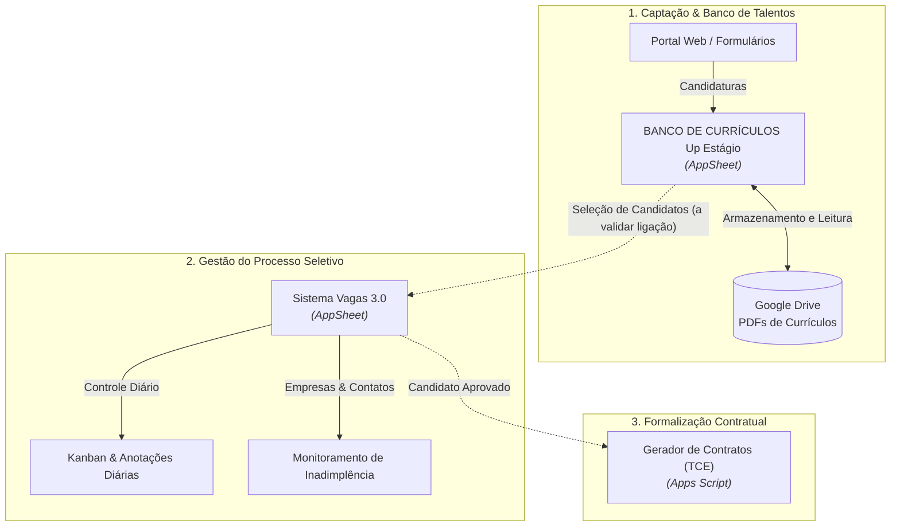

# Mapa Geral dos Sistemas — Up Estágio

> [!NOTE]
> Este documento consolida a visão oficial de todos os sistemas mapeados na Up Estágio para o projeto Start BSB (Eixo III).

---

## 1. Tabela Geral de Sistemas

| Sistema | Slug | Tipo | Etapa do Estágio | Status do Inventário | Status de Uso | Responsável / Dono |
| :--- | :--- | :--- | :--- | :--- | :--- | :--- |
| **Sistema Vagas 3.0** | `sistema-vagas-3` | AppSheet | Triagem, Kanban & Gestão de Clientes | 🟡 Em elaboração | Em uso | RH / Operação Up Estágio |
| **BANCO DE CURRÍCULOS Up Estágio** | `banco-de-curriculos` | AppSheet | Captação & Banco de Talentos | 🟡 Em elaboração | Em uso | RH / Operação Up Estágio |
| **Portal de Vagas Web** | `portal-de-vagas` | Web | Captação & Divulgação | 🔴 Na fila | Em uso | contato@upestagios.com.br |
| **Gerador de Contratos (TCE)** | `gerador-contratos-tce` | Apps Script | Formalização | 🔴 Na fila | Uso parcial | administrativo@upestagios.com.br |
| **Acompanhamento de Estágio** | `acompanhamento-avaliacoes` | AppSheet / Planilha | Acompanhamento | 🔴 Na fila | Em uso | operacao@upestagios.com.br |
| **Cobrança e Faturamento** | `faturamento-empresas` | Planilha + Script | Financeiro | 🔴 Na fila | Em uso | financeiro@upestagios.com.br |

**Legenda do Inventário:**
- 🔴 *Na fila*: Identificado, aguardando documentação inicial.
- 🟡 *Em elaboração*: Ficha criada a partir de evidências iniciais; pendente de esclarecimento de dúvidas pontuais.
- 🟢 *Concluído*: Ficha completa, validada e documentada com precisão.

---

## 2. Visão do Fluxo de Dados Identificado até o Momento

---

## 3. Próximos Passos
1. Obter respostas para as dúvidas pontuais dos dois sistemas AppSheet mapeados ([01-pendencias.md](file:///c:/Trabalho%20-%20UP%20Estágios/PROJETOS/Inventário%20dos%20Sistemas%20da%20Up%20Estágio/01-pendencias.md)).
2. Mapear os scripts Google Apps Script utilizados pela equipe.
